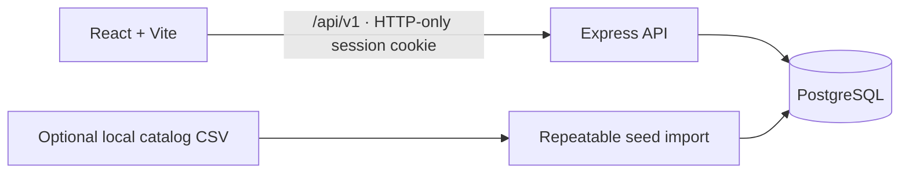

# Architecture

Streamify V2 is a simulated streaming-service application. React renders the interface, Express owns all business rules, and PostgreSQL stores accounts, catalog metadata, profiles, playback progress, demo subscriptions/payments, and audit records. The playback UI uses a timer; there is no media pipeline.

## Backend modules

- `backend/src/app.js` wires security headers, configured CORS, JSON limits, PostgreSQL sessions, rate limits, versioned routes, static production hosting, and centralized errors.
- `backend/src/config/` validates environment variables and creates the PostgreSQL pool.
- `backend/src/middleware/` contains session authentication, admin authorization, not-found, and error handling.
- `backend/src/modules/` separates auth, profiles, catalog/admin, watch history, subscriptions, and demo payments.
- `backend/src/utils/` contains async route handling, migrations, and idempotent CSV/plan seeds.
- `frontend/src/services/api.js` is the credentialed API client. `AuthContext` stores the current user in memory; the session remains in an HTTP-only cookie. The selected profile ID is only a UI convenience and is checked against the signed-in user on every API call.

Production Express serves the Vite build from `frontend/dist`; development uses Vite's `/api` proxy to Express. Set `CLIENT_ORIGIN` to the exact browser origin.

## Data flow

Registration creates a user and a default profile. A successful simulated checkout creates a demo payment and updates the active subscription in one transaction. The backend derives the amount from the selected plan. Failed checkout creates a failed demo record and leaves the subscription unchanged. Watch progress is an upsert keyed by profile and title; completed titles leave Continue Watching.

## Limitations

The dataset is third-party title metadata and does not include streaming rights, reliable artwork, or video. Missing artwork uses generated CSS poster art. Plans are sample tiers and checkout state is fictional. A local PostgreSQL service is required for authenticated app operation.
